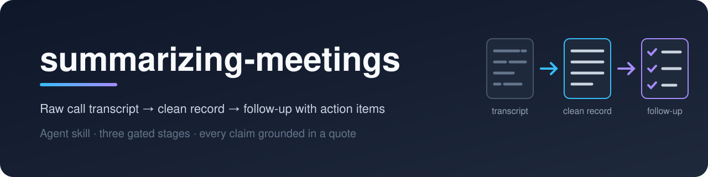

<p align="center">
  
</p>

<p align="center">
  <a href="https://www.npmjs.com/package/summarizing-meetings"></a>
  <a href="LICENSE"></a>
  <a href="https://agentskills.io/specification"></a>
</p>

# summarizing-meetings

An agent skill that turns a meeting transcript — primarily Granola, but any ASR
output works — into a clean readable record and a compact follow-up with action
items.

Conforms to the [Agent Skills open standard](https://agentskills.io/specification).

## Install

```bash
npx summarizing-meetings
```

Copies the skill to `~/.claude/skills/summarizing-meetings` (Claude Code). For
another agent, point it at that agent's skills directory; `--force` replaces an
existing install:

```bash
npx summarizing-meetings --dir ~/.agents/skills --force
```

Or from source:

```bash
git clone git@github.com:vstlmkh/summarizing-meetings.git
ln -s "$PWD/summarizing-meetings" ~/.claude/skills/summarizing-meetings
```

The symlink name must equal the `name` field in `SKILL.md`. Any agent that reads
the open-standard `SKILL.md` format can load the skill; the path above is the
Claude Code location.

## Three gated stages

1. **Agenda & intake** — the operator states the agenda, participants, meeting
   date and output language.
2. **Clean transcript** — ASR gaps are repaired without invention, profanity and
   filler are cut, speech is rewritten into attributed paragraphs, and every
   reconstruction or remaining gap is listed in an uncertainty block.
3. **Follow-up** — decisions, action items and open questions, saved to
   `followups/*.md` alongside the clean transcript.

The agent stops at the end of each stage and waits for the operator; it never
runs all three silently.

## Layout

| Path | What |
|---|---|
| `SKILL.md` | Workflow and Gotchas (ASR and Granola traps) |
| `references/transcript-cleanup.md` | Stage 2: ASR failure patterns, reconstruct-or-flag rules |
| `references/followup-formats.md` | Stage 3: three follow-up presets, file layout |
| `bin/install.js` | `npx` installer |
| `evals/` | Trigger and output-conformance scenarios, plus a sample transcript with deliberate traps |

## Design notes

The skill applies Anthropic's
[prompting best practices](https://platform.claude.com/docs/en/build-with-claude/prompt-engineering/claude-prompting-best-practices):
inputs and worked examples are wrapped in XML tags, every claim in the follow-up
is grounded in a quote from the transcript before it is written, each rule
carries the reason it exists, instructions say what to write rather than only
what to avoid, and irreversible actions (tracker writes, sending the follow-up)
are gated behind explicit approval.

## Validate

```bash
python3 ~/.claude/skills/creating-skills/scripts/validate_skill.py ~/.claude/skills/summarizing-meetings
```
